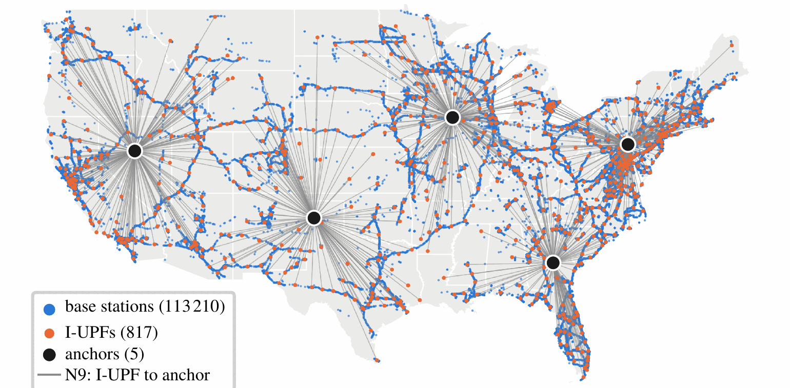
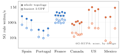
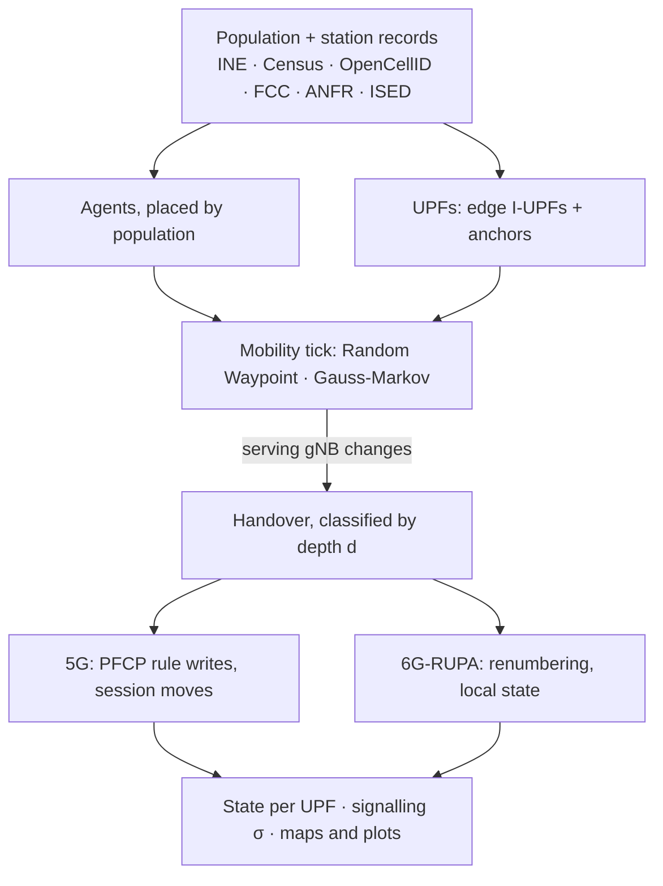

<div align="center">


# PLMN-GraphSim

**Realistic national mobile networks, built from open data.**

PLMN-GraphSim combines public datasets (census population, crowdsourced cell records and
official station registries) into national-scale network topologies, then simulates millions
of moving users on top of them.

[](https://docs.plmngraphsim.org/)
[](https://julialang.org/)
[](https://doi.org/10.34810/data3210)
[](LICENSE)

[Documentation](https://docs.plmngraphsim.org/) ·
[Quickstart](#quickstart) ·
[How it works](#how-it-works) ·
[First study](#first-study-5g-vs-6g-rupa) ·
[Citing](#citing)

<br>



<sub>Verizon, US, as simulated: <b>113 210</b> base stations, <b>817</b> I-UPFs and <b>5</b> anchors.</sub>

</div>

<br>

| At a glance | |
| :-- | :-- |
| **Open data in, a national network out** | population and boundaries (INE, US Census, INSEE, Statistics Canada, INEGI) joined with cell infrastructure (OpenCellID, FCC ASR, ANFR, ISED) |
| **6 countries, 27 operator topologies** | Spain, Portugal, France, Canada, the US and Mexico, ready to run |
| **Bring your own country** | four input files (population, boundaries, cities, cell records) and it builds the rest |
| **At national scale** | up to 113 210 base stations and 40 million sessions per topology, users placed where people live |
| **Users that move** | pedestrian, urban and highway mobility; every change of serving cell is a handover you can account for |

## What you can do with it

- **Build a realistic topology** for a country and an operator: gNBs from real records, edge
  UPFs per administrative region, session anchors, and agents distributed by population.
- **Compare data sources**: crowdsourced OpenCellID against official registries, to see how
  much a conclusion depends on the input.
- **Simulate mobility at scale** and get handover rates, handover depth and per-node state over
  time, for single-tier and two-tier cores, satellite (NTN) fallback and federated operators.
- **Plot it**: topology maps, network graphs and state evolution, ready for papers.

## First study: 5G vs 6G-RUPA

<div align="center">

</div>

In 5G, moving users keep the core busy: across the six countries, a national topology writes
**about 30 k to 1 M forwarding rules per second**, and its busiest I-UPF alone takes up to
about 150 k. 6G-RUPA writes none, by design: forwarding follows topological addresses, so a
move renumbers the user instead of rewriting rules in the core.

That study, published in IEEE Access (see [Citing](#citing)), is what PLMN-GraphSim was first
built for, and today its state accounting covers 5G and 6G-RUPA.

## How it works



1. **Topology from real data.** Municipalities, population and station records become a graph
   of gNBs, edge I-UPFs (one per second-level administrative unit above 50 k inhabitants) and
   2–5 session anchors.
2. **Agents where people live.** One simulated agent stands for 1 000 users, placed by population.
3. **Mobility on a tick.** Every tick, each agent moves under its
   [mobility model](https://docs.plmngraphsim.org/simulation-details/mobility-models/), and a
   change of nearest gNB is a handover.
4. **Architectures fed the same events.** Each handover is charged to every architecture
   being compared, from one event stream, so the comparison is apples to apples. Today that is
   5G (anchoring, PFCP rule writes, session-context moves) and 6G-RUPA (layer-scoped renumbering).

The simulator runs on [`ConcurrentSim`](https://github.com/JuliaDynamics/ConcurrentSim.jl).
It models topology, mobility, anchoring and state, not packets: there is no PHY, queueing or
TCP. For packet-level studies, export its topologies and state to a simulator such as ns-3.

## Where it's heading

The topology builder and the mobility engine do not depend on any one architecture. The goal is
a general tool for simulating mobile networks at national scale:

- **More architectures**: an architecture is a set of rules for what each handover costs, so
  others can sit next to 5G and 6G-RUPA on the same topologies and events.
- **More countries**: each new country is a data-preparation guide and four files away.
- **More mobility models**: a new model only needs a `step_position` method; trajectory replay
  and population-aware destinations are the obvious next ones.

Ideas, datasets and pull requests are welcome in the [issues](https://github.com/Fundacio-i2CAT/PLMN-GraphSim/issues).

## Quickstart

```bash
# 1. Install the Julia environment
julia --project=. -e 'using Pkg; Pkg.instantiate()'

# 2. Download the dataset (CORA v1.0, SHA-256 verified; stored under data/, outside Git)
julia --project=. scripts/download_data.jl

# 3. Run: interactive menu, or a scenario directly
julia --project=. main.jl
julia --project=. main.jl national spain
```

Start with one country to validate the environment, then move to the sweeps.

## Scenarios

| Run | What it answers | Command |
| --- | --- | --- |
| National, one country | state and handovers for one operator topology | `main.jl national spain` |
| National sweep | does the 6G-RUPA advantage survive 6 countries, 27 topologies and 4 profiles? | `main.jl national_sweep` |
| Satellite escalation | how much does NTN fallback change the picture? | `main.jl ntn_sweep` |
| Iberia and federation | what do border crossings and federated operators cost? | `main.jl iberia`, `main.jl federation` |
| Deployment sweep | is the advantage robust from a centralized core to a distributed edge? | `main.jl deployment_sweep spain` |
| Anchor sweep | does the anchor count matter? | `main.jl anchor_sweep` |
| Mobility frontend | watch agents move and hand over | `frontend/index.html` |

`julia --project=. main.jl list` shows every run. Each one is described in
[What Gets Evaluated](https://docs.plmngraphsim.org/scenarios/evaluation-runs/).

## Configuration

Countries, operators, duration, scale factor, architecture and mobility live in `config.toml`:

```toml
[countries.spain]
enabled = true
data_dir = "data/spain"
mcc = 214

  [countries.spain.operators]
  movistar = { id = 7, enabled = true }
```

<details>
<summary>Data layout</summary>

| Path | Purpose |
| --- | --- |
| `data/<country>/opencellid/<mcc>.csv` | OpenCellID attachment-point records, used as location proxies |
| `data/<country>/municipalities.csv` | municipality population and coordinates |
| `data/<country>/regions.geojson` | municipality or county boundaries |
| `data/processing_scripts/` | Python preprocessing for raw geographic datasets |

</details>

## Documentation

The full documentation is at **[docs.plmngraphsim.org](https://docs.plmngraphsim.org/)**:
[quickstart](https://docs.plmngraphsim.org/quickstart/),
[simulator internals](https://docs.plmngraphsim.org/simulation-details/how-simulator-works/),
[mobility models](https://docs.plmngraphsim.org/simulation-details/mobility-models/) and
[scenarios](https://docs.plmngraphsim.org/scenarios/).

<details>
<summary>Build the docs locally</summary>

```bash
python3 -m venv docs/.venv
docs/.venv/bin/pip install -r docs/requirements.txt
docs/.venv/bin/zensical serve      # live reload while editing
docs/.venv/bin/zensical build      # static site in public/
```

</details>

## Development

```bash
julia --project=. test/runtests.jl
julia --project=. test/qa.jl
```

<details>
<summary>Coverage report</summary>

```bash
julia --project=. scripts/post-simulation-analysis/generate_coverage_manual.jl
genhtml lcov.info --output-directory coverage_html
python3 -m http.server -d coverage_html   # then open http://localhost:8000
```

</details>

## Citing

If PLMN-GraphSim helps your research, please cite the paper it was first built for and the dataset:

```bibtex
@article{gimenez2026beyond5g,
  author  = {Gim{\'e}nez-Ant{\'o}n, Sergio and Grasa, Eduard and Day, John and
             Rizinski, Maryan and Chitkushev, Lubomir and Perell{\'o}, Jordi},
  title   = {Beyond {5G} Architectural Constraints: Designing Scalable-by-Design
             User Planes for Mobile Networks via {6G-RUPA}},
  journal = {IEEE Access},
  volume  = {14},
  pages   = {160298--160318},
  year    = {2026},
  doi     = {10.1109/ACCESS.2026.3743970}
}

@dataset{plmngraphsim_dataset_2026,
  title     = {{PLMN-GraphSim} dataset for "Beyond {5G} Architectural Constraints:
               Designing Scalable-by-Design User Planes for Mobile Networks via {6G-RUPA}"},
  publisher = {CORA. Repositori de Dades de Recerca},
  version   = {1.0},
  year      = {2026},
  doi       = {10.34810/data3210}
}
```

## License

PLMN-GraphSim is released under the [AGPL-3.0](LICENSE).

<div align="center">
<br>
<sub>Built at <a href="https://i2cat.net/">Fundació i2CAT</a>. First developed for the
<a href="https://6grupa.com">6G-RUPA</a> research.</sub>
</div>
