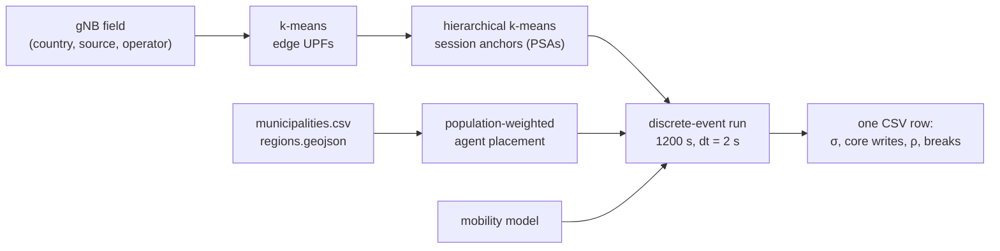

# What Gets Evaluated

Every number this project reports comes from one of six runs in `runs/`, each dispatched
through `main.jl <run>`. This page states, for each one, what it holds fixed, what it
varies, and what claim it is there to establish — so a reader can tell which run a
figure came from and what that figure is and is not evidence for.

The mechanics behind the numbers live elsewhere: what a mobility event costs is in
[The Signaling Cost Model](../simulation-details/signaling-cost-model.md), how UPFs and
anchors are placed is in [UPF Placement Strategy](../simulation-details/k-means.md), and
how agents move is in [Mobility Models](../simulation-details/mobility-models.md).

## The Unit of Evaluation

One row of output is one **run**: a deployed topology, a mobility model, and a duration.

Nothing in that chain is stored between runs. The topology is rebuilt from the gNB field
on every invocation, so a result can never drift from its input.

### Scaffolding common to every run

| Quantity | Value | Why |
|---|---|---|
| Duration | 1200 s | Long enough for the slowest profile to accumulate a stable handover rate |
| Mobility tick | 2 s | Below the shortest cell dwell time at 120 km/h |
| Adoption | 0.82 | Share of population holding an active subscription |
| Scale factor | 1000 | One simulated agent represents 1000 users; absolute counts are scaled back up on output |
| Agents | `population × 0.82 / 1000` | Ties demand to the real country rather than a round number |
| Edge UPFs | Second-level administrative units above 50 k inhabitants | A deployment an operator would plausibly build |
| Session anchors | `round(pop / 10M)` clamped to `[2, 5]` | See [`anchor_sweep`](#anchor_sweep-does-the-anchor-count-matter), which exists because this rule is a guess |

### Mobility profiles

| Profile | Model | Speed |
|---|---|---|
| `stationary` | `NoMobility` | 0 km/h |
| `pedestrian` | `RandomWaypoint(5.0, 0.0, 2.0)` | 5 km/h |
| `urban` | `RandomWaypoint(50.0, 0.0, 20.0)` | 50 km/h |
| `highway` | `GaussMarkov(120.0, 0.85, 5.0)` | 120 km/h |

The profiles are not predictions of real travel. They are a 64× spread in handover rate,
used to show the σ ratio does not move when the event rate does.

### What is measured

| Metric | Meaning |
|---|---|
| `handovers` | Serving-cell changes, split into L1 (same edge UPF), L2 (edge change, anchor pinned), L3 (anchor region crossing) |
| `sigma_*_bytes` | Transient control-plane bytes to complete the observed events, charged per depth |
| `sigma_advantage_pct` | `(1 − σ_6G / σ_5G) × 100`, the headline ratio |
| `core_writes_*` | Per-session forwarding-state writes in the core — the state-churn quantity, distinct from σ |
| `anchor_dist_5g_km`, `anchor_dist_opt_km` | Mean user→anchor distance under the pinned 5G anchor versus the nearest available anchor |
| `stretch_excess_km` (ρ) | The difference between the two — the cost of SSC-1 pinning |
| `session_breaks_5g` | Sessions torn down at a boundary crossing under `reestablish` semantics |

## The Six Runs

### `national_sweep` — does the σ result survive real-world variation?

**Varies:** 27 (country, source, operator) targets × 3 mobility profiles → 81 rows.

**Holds fixed:** the deployment rule, duration, adoption, scale.

Six countries; nine gNB fields, three of which pair a crowdsourced OpenCellID field with
the country's official registry (FCC ASR, ANFR BNIR, ISED); every major operator in each
country selected by its real MNC.

This is the run that answers "is the advantage an artifact of one dataset?". It spans a
64× handover-rate range, a 45× edge-UPF range (18 → 817), two continents, and two
independent kinds of data source. If σ advantage were an artifact of density, of
crowdsourcing bias, or of one country's geography, it would move here.

!!! note "Why the paired registries matter"
    OpenCellID rows are *cells*; registry rows are *sites*. The crowdsourced fields run
    2–3× above the registries in station count for the same country and operator. The σ
    advantage moves by less than a point across the pair. That is a stronger control than
    varying density synthetically, because the two fields disagree about the same
    physical network.

### `churn_data_usa` — is the churn claim really O(n)?

**Varies:** represented population, 1 M → 274.7 M active users.

**Holds fixed:** one deployment (Verizon US, 817 edge UPFs, 5 anchors, highway).

`national_sweep` shows core writes growing across countries, but countries differ in more
than population. This run isolates the scaling by changing only the user count. It is the
direct evidence for the O(n) versus zero-growth claim.

### `anchor_sweep` — does the anchor count matter?

**Varies:** 6 countries × anchor counts {2, 5, 10, 20, 40} × {pedestrian, highway} → 60 rows.

**Holds fixed:** the edge-UPF partition.

Operators do not publish anchor counts, and no citable figure exists in either the 3GPP
or the GSMA corpus. Every other run therefore fixes the count with a rule dominated by
its own clamp — `round(pop / 10M)` bounded to `[2, 5]` gives 5 for both Spain and the
United States despite a 6.8× population gap. That is only defensible if the reported
quantities are insensitive to the choice, which is what this run tests.

The anchor set is re-clustered at each count, so every row is a genuine redeployment.

**Expected:** σ and core writes flat, because both are set by the edge-UPF partition, not
the anchor tier. **Observed:** confirmed — σ advantage stays within 66.84–68.64% across a
20× range in anchors, and 6G-RUPA core writes are 0 everywhere.

!!! warning "ρ rises with anchor density — and that is correct"
    The run script originally predicted ρ would *fall* as anchors are added, on the
    reasoning that a denser anchor set puts one nearer the user. The data show the
    opposite, and the data are right: 5G pins the session anchor at attach, so adding
    anchors improves the *optimal* reference faster than it improves the *pinned* one.
    ρ measures the penalty of pinning, and that penalty grows as the anchor set gets
    denser. Read ρ as a cost of SSC-1, not as a deployment-quality score.

!!! danger "Clamp artifact at high anchor counts"
    Anchor placement clamps to `k = min(requested, #edge UPFs)`
    (`perform_hierarchical_clustering` in `src/DataLoading/Loader.jl`). A country with
    fewer edge UPFs than the requested anchor count silently runs at the smaller number,
    while the output CSV records the *request*. At `k = #edge UPFs` every edge UPF becomes
    its own anchor, `anchor_dist_opt_km` collapses to exactly 0, and ρ degenerates into
    the full pinned-anchor distance. Portugal (18 edge UPFs) hits this at 20 and 40
    anchors. Treat such rows as a boundary artifact, not as trend points.

### `federation_continental` — what does joining a federation cost?

**Varies:** 2 continental federations × K = 2..6 members × both 5G semantics × 3 profiles → 60 rows.

**Holds fixed:** each member keeps its national edge/anchor partition on joining.

Each federation spans a contiguous landmass and adds a **country** before it adds a second
operator within one, so growing K widens the geography rather than the operator list:

- `europe`: Movistar ES → MEO PT → Orange FR → Vodafone ES → NOS PT → SFR FR
- `north_america`: Verizon US → Telus CA → Telcel MX → AT&T US → Rogers CA → Movistar MX

Contiguity matters because an inter-member crossing has to be reachable on the ground.
The two federations differ by an order of magnitude in area and in coverage gap, which is
the point: the per-crossing cost should not care, and it does not — the roaming σ
advantage is identical to two decimal places on both continents.

This run also produces the membership-state result: the 5G bilateral mesh grows O(K²)
while RUPA internetwork-DIF enrollments grow O(K).

!!! info "The two 5G semantics"
    `reestablish` tears the session down at the boundary and rebuilds it; `ideal_ho`
    assumes a pre-negotiated inter-operator handover with no break. They bracket real
    roaming behaviour, and the advantage is reported under both because the gap between
    them (86.15% vs 65.39%) is larger than any other effect in the study.

### `ntn_sweep` — how much does satellite fallback change the picture?

**Varies:** 9 (country, source) targets × r_terr ∈ {5, 10, 20, 30} km × 3 profiles ×
{Xn, N2} satellite handover semantics → 216 rows.

**Holds fixed:** 50 000-agent cap per target, seed 20260728, Starlink 550 km shell
propagated with SGP4 at a 25° minimum elevation.

An earlier version fixed the terrestrial side to one composed Iberian field. That is the
wrong control, because how often a user falls off terrestrial coverage is a property of
the country — Canada, Mexico and the United States have far larger gaps than France or
Spain. This run therefore puts the same constellation against each national field in
turn, and runs the official registries alongside the crowdsourced fields, because
satellite attachment is driven by coverage holes and crowdsourced fields overstate holes
substantially.

The agent cap is what makes satellite-served share comparable: every country costs the
same, so the reported share stays a per-agent statistic rather than a population artifact.

!!! note "The stationary-network effect"
    Including a zero-speed profile is not padding. Serving-satellite changes accumulate
    without any user motion, because the constellation moves. It is the one mobility
    event in this study that is a property of the network rather than of the user.

### `trajectories` — visual output only

Emits per-agent traces for the deck.gl viewer. Not an input to any reported number.

## Reproducibility

Only `ntn_sweep` is bit-reproducible. It calls `Random.seed!` before building each target
and derives a deterministic per-case seed, so the same command twice gives byte-identical
output.

`national_sweep`, `anchor_sweep`, `federation_continental` and `churn_data_usa` set no
seed. k-means placement, population-weighted agent placement and mobility all draw from
Julia's global RNG, which is seeded from system entropy per process, so each run gets a
different topology and a different agent population.

That is not fatal, but it has to be stated with a number attached. Five (country,
operator) targets are run at the same anchor count, agent count and duration by both
`national_sweep` and `anchor_sweep`, in independent processes — ten natural replicate
pairs at full production scale:

| Quantity | Max deviation | Mean deviation |
|---|---|---|
| `sigma_advantage_pct` | 0.16% relative (≤0.11 pp) | 0.07% |
| `handovers` | 0.95% | 0.50% |
| `core_writes_5g` | 1.07% | 0.54% |
| `core_writes_6grupa` | exactly 0 in every row | — |
| `stretch_excess_km` (ρ) | 236% | 70% |

The headline ratio is stable to a tenth of a percentage point across independent runs.
That is a stronger statement than bit-determinism would be, because it holds across a
resampled topology and a resampled user population rather than across a replayed one.

!!! danger "ρ does not replicate per row"
    ρ is a rare-event mean over a bulk denominator. Every handover samples
    `d_pinned − d_nearest` (`Simulation/Handover.jl:345`), but while the user is inside
    their own anchor region the pinned anchor *is* the nearest one, so the sample is
    exactly 0 and still counts in the denominator. Only handovers made while displaced
    into another anchor region contribute — and crossings are 0.03–0.17% of all
    handovers. One sample in a thousand carries tens to hundreds of kilometres; the rest
    dilute it.

    Both factors are noisy. Crossing counts are small and Poisson-scattered (9 vs 11,
    65 vs 43 across replicate pairs), and the mass per crossing depends on how deep the
    user wandered and how many handovers they made before returning — heavy-tailed, and
    dominated by a few users. Correlation between ρ and the crossing rate is only
    0.27–0.91 within a country, so the count alone does not explain ρ's movement.

    Quote ρ as an order of magnitude or as a direction, never as a per-row value. The
    rise of ρ with anchor density survives precisely because it is a 16–132× effect
    holding in all 12 country/profile cases, well clear of the noise floor.

    **More compute does not fix this.** Measured over 24 independent runs at each of two
    scales (Portugal, 300 agents/120 s and 1500 agents/300 s, a 12.5× work increase):
    σ advantage, handovers and core writes shrink by 0.38/0.38/0.46 against the 0.283
    expected from 1/√N, i.e. textbook sampling noise. But the underlying anchor distances
    shrink only 13.85% → 10.21% CV, a ratio of 0.74. That component is the k-means
    topology draw, not the sample — it does not shrink with longer runs or more agents.
    ρ is a sub-percent residual of those distances and inherits the floor amplified.
    Only seeding the placement, or averaging over many topology draws, removes it.

!!! success "Why the bulk metrics are stable"
    σ advantage is a *ratio over the same event stream*: 5G and 6G-RUPA are charged for
    the identical events, so the event count cancels and only the depth mix survives.
    The mix is a bulk property — the L1 share replicates to within 0.3 pp — which is why
    the ratio lands within 0.11 pp across independent runs. Handovers and core writes are
    plain sums over every event, so ordinary averaging applies. Nothing in either
    quantity depends on a rare tail.

!!! warning "`ntn_sweep` seeds off list position, not range value"
    The per-case seed is `SEED + 100·ri + mi`, where `ri` indexes the range inside
    `R_SWEEP`. Passing one range gives `ri = 1`; passing `5,10,20,30` gives r = 10 the
    index 2. The same physical configuration therefore gets a different seed depending on
    how the sweep was partitioned — measured at 11.28% versus 9.33% satellite-served
    share for Portugal at r_terr = 10 km. Published results were produced one
    (target, range) shard at a time, so reruns must be sharded the same way to match.
    Keying the seed off the range value instead would remove the coupling, at the cost of
    invalidating the published numbers.

## Reading the Runs Together

Each run controls for something the others cannot:

| Question | Controlled by |
|---|---|
| Is it one dataset? | `national_sweep` — 9 fields, 6 countries, 2 source kinds |
| Is it the data source? | `national_sweep` — paired registry vs crowdsourced fields |
| Is it the handover rate? | `national_sweep` — 64× rate range across profiles |
| Is it the deployment size? | `national_sweep` — 45× edge-UPF range |
| Is it the population? | `churn_data_usa` — population swept, deployment fixed |
| Is it the anchor guess? | `anchor_sweep` — 20× anchor range, deployment otherwise fixed |
| Is it the federation size or geography? | `federation_continental` — K = 2..6 on two continents |
| Does non-terrestrial access change it? | `ntn_sweep` — 4 coverage thresholds × 9 fields |

The σ advantage is stable across every one of these axes. That stability is the result;
the individual numbers are how it is demonstrated.
