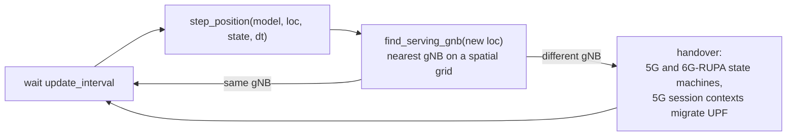
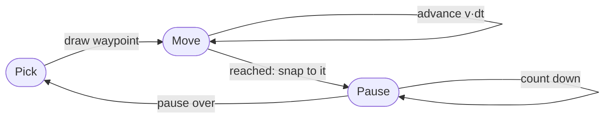

# Mobility Models

A mobility model decides where an agent is after each tick. The simulator then asks which
gNB serves that position, and a change of serving gNB is a handover. Everything the
[mobility scenario](../scenarios/mobility/setup.md) measures (handover rate, signalling
cost, forwarding-state churn) comes out of that loop, so the model sets the event rate.

The code is in `src/Simulation/Mobility.jl` (one `step_position` method per model) and
the types in `src/Types.jl`.

## The Tick Loop

Mobile agents run `lifecycle_embb_mobile` instead of the stationary `lifecycle_embb`.
After attaching, every `update_interval` seconds they do the following:

- **The serving gNB is the nearest one.** There is no radio model: cells are the
  Voronoi regions of the gNB positions.
- **`update_interval` is the handover-detection granularity.** If an agent crosses two
  cells within one interval, the simulator sees a single handover. At 120 km/h a 2 s
  tick covers about 67 m, so the interval has to stay well below the cell dwell time. The
  sweeps use 1–2 s.
- **Each agent keeps a `MobilityState`:** its current waypoint, the time left to reach
  it, a pause countdown and a velocity vector. Stateless models ignore it.

Positions are latitude and longitude. Displacements are computed in kilometres and
converted with a local equirectangular approximation (111 132 m per degree of
latitude, scaled by cos(latitude) for longitude). The error is negligible at the
distances one tick covers.

## NoMobility

The agent never moves: `step_position` returns the same location. It is the stationary
baseline of the single-tier and two-tier scenarios. With `mobility.enabled = false` the
simulator keeps the original stationary lifecycle, so those experiments reproduce bit
for bit.

## Random Waypoint

`RandomWaypoint(speed_kmh, pause_time, max_jump_km)`

The agent picks a destination, walks to it in a straight line at constant speed, pauses,
and picks the next one.

When the pause ends, a new route starts on the same tick. The next waypoint is drawn
uniformly over a disk of radius `max_jump_km` around the current position:

$$
\theta \sim \mathcal{U}(0, 2\pi), \qquad r = r_{\max}\sqrt{u},\; u \sim \mathcal{U}(0,1)
$$

The square root makes the density uniform over the disk's area rather than crowding
points near its centre. On each tick the agent advances $v\,\Delta t$ along the straight
line to the waypoint. If that step would reach or overshoot it, the agent lands exactly
on the waypoint and starts its pause.

| Parameter | Meaning |
|---|---|
| `speed_kmh` | constant travel speed |
| `pause_time` | seconds spent at each waypoint (0 in every published profile) |
| `max_jump_km` | radius of the disk the next waypoint is drawn from |

Random waypoint is a good fit while one tick's displacement is small compared to a cell.
Because each new heading is independent, a fast agent zig-zags in a way no vehicle does,
and that is why the highway profile uses Gauss-Markov instead.

## Gauss-Markov

`GaussMarkov(speed_kmh, alpha, max_acceleration)`

The velocity carries memory from one tick to the next, so headings drift instead of
jumping. A 120 km/h agent travels like a car on a road, not like a particle bouncing
between random points.

On the first tick the agent is given a random heading at full speed, so the motion is
sustained travel and not a zero-mean random walk. On every tick after that:

$$
\vec{v}_n = \alpha\,\vec{v}_{n-1} + (1-\alpha)\,\vec{\mu}_n + \sqrt{1-\alpha^2}\;\sigma\,\vec{\xi}_n,
\qquad \sigma = a_{\max}\,\Delta t
$$

- $\vec{\mu}_n$ points along the current heading with magnitude equal to the mean speed.
- $\vec{\xi}_n$ has independent components uniform in $[-1, 1]$.
- $a_{\max}$ is `max_acceleration`, which bounds how much speed and heading can change per tick.

The vector is then rescaled back to the mean speed, so the agent never slows down or
stalls. Only its direction wanders. The position advances by $\vec{v}_n\,\Delta t$.

| Parameter | Meaning |
|---|---|
| `speed_kmh` | mean (and, after renormalisation, constant) speed |
| `alpha` | memory: 0 = a new random direction every tick, 1 = a straight line forever |
| `max_acceleration` | m/s², scale of the per-tick perturbation |

!!! note "Not reachable from `config.toml`"
    `config.toml` only accepts `none` and `random_waypoint`. The highway profile is
    built in Julia by the sweep runners; see the warning on the
    [setup page](../scenarios/mobility/setup.md#configuration).

## The Published Profiles

| Profile | Model | Reading |
|---|---|---|
| `stationary` | `NoMobility()` | baseline |
| `pedestrian` | `RandomWaypoint(5.0, 0.0, 2.0)` | 5 km/h to points up to 2 km away |
| `urban` | `RandomWaypoint(50.0, 0.0, 20.0)` | 50 km/h to points up to 20 km away |
| `highway` | `GaussMarkov(120.0, 0.85, 5.0)` | 120 km/h, heading memory 0.85, 5 m/s² |

None of the profiles pauses at waypoints.

The profiles are not predictions of real travel. Together they span a 64× range in
handover rate, which is what the evaluation needs: it shows that the σ ratio between 5G
and 6G-RUPA stays put while the event rate changes by more than an order of magnitude.

## Limitations

- **No road network.** Agents move in free space; they are not routed along streets or
  highways.
- **No geographic boundary.** Positions are not clamped to land or to the country. An
  agent that drifts offshore is still served by its nearest gNB.
- **Speed is constant per profile.** There is no speed distribution within a profile,
  and no stops apart from Random Waypoint pauses.
- **Cells come from distance only.** The nearest gNB wins; load, frequency bands and
  radio conditions are not modelled.

The `MobilityModel` abstract type is the extension point: a new model (trajectory
replay, population-aware destinations) only needs a `step_position` method, and the
lifecycle code does not change.
